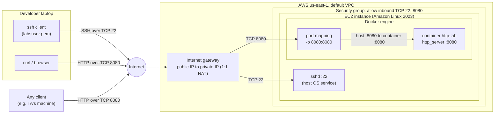

# TDA596 Lab 1: HTTP Server and Pub-Sub Broker

A concurrent HTTP/1.0 file server with a built-in pub-sub broker, written in Go on top of raw TCP sockets (`net.Listen`). The `net/http` package is used only to parse requests.

- Assignment summary: `docs/ASSIGNMENT.pdf`
- Design notes (Traditional Chinese): `docs/DESIGN.md`
- Test suite: `lab1-demo-tests/README.md`

## Contents

- [Folder Architecture](#folder-architecture)
- [Design Overview](#design-overview)
- [Quick Start](#quick-start)
- [Docker Deployment](#docker-deployment)
- [AWS Deployment](#aws-deployment)
- [Testing](#testing)
- [API Reference](#api-reference)

## Folder Architecture

```
.
├── main.go                  # Entry point: listener, 10-slot limit, routing, file server, response writer
├── broker.go                # Pub-sub broker: state, subscribe/publish/unsubscribe, long-polling events
├── go.mod                   # Go module definition (Go 1.27)
├── Dockerfile               # Multi-stage build: golang:1.27 → scratch
├── www/                     # Document root served by the server
│   ├── hello.txt
│   ├── upload.txt
│   └── lab1-demo-fixtures/  # Sample files used by the GET test
├── lab1-demo-tests/         # Python test suite (standard library only)
│   ├── 01_…13_*.py          # One script per test case
│   ├── common.py            # Shared HTTP helpers
│   ├── fixtures/            # Source copies of the sample files
│   ├── README.md            # Test instructions (English)
│   └── README-cn.md         # Test instructions (Chinese)
└── docs/
    ├── ASSIGNMENT.md        # Summary of the assignment requirements
    └── DESIGN.zh-TW.md      # Design notes: roles, connections, errors, mechanisms
```

|File|Main contents|
|---|---|
|`main.go`|`main()`, `handleConnection()`, `saveUpload()`, `writeResponse()`, `handleUnsubscribe()`|
|`broker.go`|`Broker`, `Subscriber`, `Message`, `subscribe()`, `publish()`, `unsubscribe()`, `handleSubscribe()`, `handlePublish()`, `handleEvents()`|

## Design Overview
More details are in `docs/DESIGN.zh-TW.md`.
```
┌────────────────────────── Server (http_server) ──────────────────────────┐
│                                                                          │
│  File server (main.go)              Broker (broker.go)                   │
│  ├ Listener + 10 slots              ├ topics: "news"  → {1, 3}           │
│  ├ Parse, check, route by path      │         "sport" → {2}              │
│  ├ GET / POST files                 ├ One queue (cap 10) per subscriber  │
│  └ www/ (via os.Root)               └ nextId, lastSequence, mu           │
│                                                                          │
└───────────────────────────────────▲──────────────────────────────────────┘
                                    │ every connection: 
                                    │ client → server (TCP), one request each
          ┌─────────────────────────┼─────────────────────────┐
          │                         │                         │
      Publisher                Subscriber              Plain client
   (POST /publish) (/subscribe, /events,/unsubscribe) (GET / POST files)
```

## Quick Start

### Prerequisites

|Option|Requirements|
|---|---|
|Docker (recommended)|Docker Desktop or Docker Engine|
|Without Docker|Go 1.27 or later (see `go.mod`)|
|Tests|Python 3.8 or later|

### Option A: Docker (recommended)

From the repository root:

```bash
docker build -t http-lab .
docker run -d --rm --name http-lab-demo -p 127.0.0.1:8081:8080 http-lab
curl -i http://127.0.0.1:8081/hello.txt
docker stop http-lab-demo
```

See `Docker Deployment` for details.

### Option B: Without Docker

The server opens `www/` relative to the current directory, so start it from the repository root:

```bash
go build -o http_server .
./http_server 8080
```

Or compile and run in one step:

```bash
go run . 8080
```

Stop the server with `Ctrl+C`.

> **Windows:** Build with `go build -o http_server.exe .` and run `.\http_server.exe 8080`. Use `curl.exe` instead of `curl` in Windows PowerShell.

## Docker Deployment

### Image

The `Dockerfile` uses a multi-stage build:

|Stage|Base image|What happens|
|---|---|---|
|`build`|`golang:1.27`|Compiles a fully static binary with `CGO_ENABLED=0`|
|`Final`|`scratch` (empty)|Contains only `/app/http_server` and `/app/www/`|

- `WORKDIR /app` is required: the server opens `www/` relative to its working directory.
- `ENTRYPOINT ["/app/http_server"]` is the program and `CMD ["8080"]` is the default port.

### Build

```bash
docker build -t http-lab .
```

Rebuild after changing any `.go` file or anything under `www/`.

### Run

```bash
docker run -d --rm --name http-lab-demo -p 127.0.0.1:8081:8080 http-lab
```

| Option                   | Meaning                                                                             |
| ------------------------ | ----------------------------------------------------------------------------------- |
| `-d`                     | Run in the background                                                               |
| `--rm`                   | Remove the container when it stops                                                  |
| `--name http-lab-demo`   | Container name, used by `logs`, `cp` and `stop`                                     |
| `-p 127.0.0.1:8081:8080` | Host `127.0.0.1:8081` → container port `8080`; <br>only reachable from this machine |
| `http-lab`               | Image name                                                                          |

```bash
docker run -d --rm --name http-lab-9090 -p 127.0.0.1:9090:9090 http-lab 9090
```

### Inspect

```bash
docker ps                                          # Running containers
docker logs -f http-lab-demo                       # Request log (Ctrl+C stops following)
docker cp http-lab-demo:/app/www ./www-snapshot    # Copy the container's www/ to the host
```

Files uploaded with `POST` are stored inside the container at `/app/www/`, not in the repository's `www/`. They are lost when the container is removed.

### Stop and clean up

```bash
docker stop http-lab-demo     # With --rm, this also removes the container
docker rmi http-lab           # Remove the image
```

## AWS Deployment

The server runs on an EC2 instance in AWS Academy Learner Lab, using the same Docker image as the local setup. Clients reach it over the internet at `http://<public-ip>:8080`.

### Architecture



SSH and HTTP are both application protocols on top of TCP. They differ in the destination port, and therefore in which program on the instance receives the connection.

#### SSH path (TCP 22): from your laptop to the instance's shell
1. `ssh -i labsuser.pem ec2-user@<public-ip>` opens a TCP connection to `<public-ip>:22`.
2. The internet gateway translates the public IP to the instance's private IP (`172.31.x.x`). The instance itself only knows its private IP.
3. The security group checks the inbound rule for TCP 22 and lets the connection in.
4. The kernel on the instance hands the connection to `sshd`, the SSH service of the host OS.
5. SSH verifies the host key, then logs you in with the private key in `labsuser.pem`. AWS installed the matching public key (`vockey`) for `ec2-user` when it launched the instance.
6. `sshd` starts a shell for `ec2-user`. Commands travel encrypted over this connection.

#### HTTP path (TCP 8080): from any client to `http_server`
1. `curl http://<public-ip>:8080/...` opens a TCP connection to `<public-ip>:8080`.
2. The internet gateway translates the public IP to the private IP, as for SSH.
3. The security group checks the inbound rule for TCP 8080 and lets the connection in.
4. Docker forwards host port 8080 to port 8080 in the container (`-p 8080:8080`).
5. `http_server` accepts the connection and handles the request.
6. The response returns the same way. The security group is stateful, so replies to an allowed connection need no outbound rule.

#### Outbound connections
The instance also opens connections to the internet: `dnf install` to the Amazon Linux repositories, `git clone` to GitHub, and `docker build` to Docker Hub for the `golang:1.27` image. The security group allows all outbound traffic by default.

### Instance settings

|Setting|Value|
|---|---|
|Region|`us-east-1` (N. Virginia). Learner Lab only allows `us-east-1` and `us-west-2`.|
|Name|`tda596-lab1`|
|AMI|Amazon Linux 2023|
|Instance type|`t3.micro` (2 vCPU, 1 GiB RAM)|
|Key pair|`vockey` (private key: `labsuser.pem`)|
|Auto-assign public IP|**Enable**|
|Security group|New group `tda596-lab1-sg`|
|Storage|Default (8 GiB gp3)|

Inbound rules:

|Type|Protocol|Port|Source|Purpose|
|---|---|---|---|---|
|SSH|TCP|22|Anywhere (`0.0.0.0/0`)|Log in to deploy and maintain the server|
|Custom TCP|TCP|8080|Anywhere (`0.0.0.0/0`)|The HTTP server and pub-sub broker|

SSH is open to all addresses so it works from any network. Login still requires `labsuser.pem`, because password login is disabled on Amazon Linux. Keep the key private and never commit it (`*.pem` is in `.gitignore`).

### 1. Start the lab and download the key
1. Log in to [AWS Academy](https://awsacademy.instructure.com/) → **Modules** → **Launch AWS Academy Learner Lab**.
2. Click **Start Lab** and wait until the dot next to **AWS** turns green.
3. Open **AWS Details** → **SSH key** → **Download PEM**. This saves `labsuser.pem`.
4. Click **AWS** to open the console. Check that the region in the top right is **us-east-1**.

### 2. Launch the instance
1. Open **EC2** → **Launch instance**.
2. Fill in the name, AMI, instance type, and key pair from the table above.
3. Under **Network settings**, click **Edit**:
    - Check that **Auto-assign public IP** is **Enable**. 
	    - Without a public IP the instance cannot be reached from the internet.
    - Select **Create security group**, name it `tda596-lab1-sg`.
    - Rule 1 (**SSH**): set **Source type** to **Anywhere**.
    - Click **Add security group rule** for rule 2: **Custom TCP**, port `8080`, source **Anywhere**.
4. Keep storage and advanced details at their defaults. Then click **Launch instance**.
5. Open **Instances**, wait until **2/2 checks pass**, then copy the **Public IPv4 address**.

### 3. Connect with SSH

Windows PowerShell, in the folder that contains the key:

```powershell
icacls labsuser.pem /inheritance:r /grant:r "$($env:USERNAME):R"
ssh -i labsuser.pem ec2-user@<public-ip>
```

On macOS or Linux, run `chmod 400 labsuser.pem` instead of `icacls`. SSH refuses a private key that other users can read.

On the first connection, SSH shows the host's key fingerprint and asks `Are you sure you want to continue connecting?`. Type `yes`. The fingerprint is saved in `~/.ssh/known_hosts`, and later connections to the same host do not ask again.

The prompt changes to `[ec2-user@...]$` once you are logged in. All following commands run on the instance until you type `exit`.

### 4. Install Docker and Git

```bash
sudo dnf install -y docker git
sudo systemctl enable --now docker      # start Docker now and on every boot
sudo usermod -aG docker ec2-user        # run docker without sudo
exit
```

Log in again with the same `ssh` command so the new group membership takes effect.

### 5. Get the code

```bash
git clone https://github.com/Aroma-Arise/distributed-system-Lab1.git
cd distributed-system-Lab1
git log --oneline -3     # confirm this is the latest main
```

If the repository is private, Git asks for a username and password. Enter your GitHub username, and as the password a **personal access token** with read-only **Contents** permission for this repository (GitHub → Settings → Developer settings → Personal access tokens).

### 6. Build and run

```bash
mkdir -p www/lab1-demo-fixtures
cp lab1-demo-tests/fixtures/* www/lab1-demo-fixtures/
docker build -t http-lab .
docker run -d --restart unless-stopped --name http-lab -p 8080:8080 http-lab
```

Copy the fixtures before `docker build`, because the image only contains the files in `www/` at build time. The first build takes 1–3 minutes, mostly to download the `golang:1.27` image.

Two options differ from the local setup:

| Option   | Local                 | EC2                        | Reason                                                                                                                                                 |
| -------- | --------------------- | -------------------------- | ------------------------------------------------------------------------------------------------------------------------------------------------------ |
| `-p`     | `127.0.0.1:8081:8080` | `8080:8080`                | The server must accept connections from outside the instance.                                                                                          |
| Lifetime | `--rm`                | `--restart unless-stopped` | Learner Lab stops the instance when a session ends.  With `systemctl enable docker`, the container starts again automatically when the instance boots. |

Check that the container is up and answers locally:

```bash
docker ps        # STATUS "Up ...", PORTS "0.0.0.0:8080->8080/tcp"
curl -i -X POST "http://localhost:8080/subscribe?topic=test"     # 201 Created, {"id":1}
```

### 7. Test

From your own machine (use `curl.exe` on Windows PowerShell):

```bash
curl -i -X POST "http://<public-ip>:8080/subscribe?topic=cloud"       # 201 Created
curl -i "http://<public-ip>:8080/lab1-demo-fixtures/<fixture-file>"   # 200 OK
```

The same URLs work in a browser. Use `http://` and include `:8080`.

### 8. Stop the instance

1. Type `exit` to leave the SSH session. The server keeps running.
2. In the console, select the instance → **Instance state** → **Stop instance**.
3. Optionally click **End Lab** in Learner Lab. The session also ends by itself after 4 hours.

### Restart for the demo

1. Learner Lab → **Start Lab**, wait for the green dot.
    
2. EC2 → **Instances**. If the instance is **Stopped**, select it → **Instance state** → **Start instance**.
    
3. Copy the **new public IPv4 address**. It changes every time the instance starts.
    
4. Check from your own machine:
```bash
curl -i -X POST "http://<new-public-ip>:8080/subscribe?topic=demo"   # 201 Created
```
    
Docker and the container start automatically on boot, so no SSH is needed.


## Testing

More detailed testing descriptions are in `lab1-demo-tests/README.md`.

Start the server first. Option A uses port 8081, which is the default for the tests.

Run a single test:

```bash
python3 lab1-demo-tests/01_get_file_types.py
```

Run all tests and stop at the first failure:

```bash
# macOS / Linux
for test_file in lab1-demo-tests/[0-9][0-9]_*.py; do
  python3 "$test_file" || break
done
```

```powershell
# Windows PowerShell
foreach ($f in Get-ChildItem lab1-demo-tests\*.py | Where-Object Name -match '^\d\d_' | Sort-Object Name) {
    python $f.FullName
    if ($LASTEXITCODE -ne 0) { break }
}
```

If the server runs directly on port 8080 (Option B), add `--port 8080` to each script.

## API Reference

### File server

|Request|Success|Errors|
|---|---|---|
|`GET /<path>`|`200` with the file and its Content-Type|`400` invalid path or unsupported type, `404` not found|
|`POST /<path>`|`200 File saved`|`400` invalid path, unsupported type, or save failure|
|Any other method|—|`501`|

- **Read a file**

```bash
curl -i http://127.0.0.1:8081/hello.txt
```

```
HTTP/1.0 200 OK
Content-Type: text/plain

This is from a file.
```

- **Upload a file, then read it back**

```bash
curl -i -X POST --data-binary 'hello from POST' http://127.0.0.1:8081/notes.txt
curl -i http://127.0.0.1:8081/notes.txt
```

```
HTTP/1.0 200 OK
Content-Type: text/plain

File saved
```

```
HTTP/1.0 200 OK
Content-Type: text/plain

hello from POST
```

To upload an existing file, use `--data-binary @<local-file>`.
For example, `--data-binary @photo.jpg http://127.0.0.1:8081/photo.jpg`. 
The target directory must already exist under `www/`.

**Error cases**

```bash
curl -i http://127.0.0.1:8081/missing.html          # 404 File not found
curl -i http://127.0.0.1:8081/image.png             # 400 Unsupported file type
curl -i -X DELETE http://127.0.0.1:8081/hello.txt   # 501 Method not implemented
```

### Pub-sub broker

|Request|Success|Errors|
|---|---|---|
|`POST /subscribe?topic=X`|`201` `{"id":N}`|`400` missing topic|
|`POST /publish?topic=X`|`200` `{"delivered":N}`|`400` missing topic|
|`GET /events?topic=X&id=N`|`200` with the message, or `204` after 10 s|`400` invalid id, `404` unknown subscriber, `409` already polling|
|`POST /unsubscribe?topic=X&id=N`|`200`|`400` invalid id, `404` unknown subscriber|

Wrong methods on broker endpoints return `501`.

**1. Subscribe to a topic**

```bash
curl -i -X POST 'http://127.0.0.1:8081/subscribe?topic=news'
```

```
HTTP/1.0 201 Created
Content-Type: application/json

{"id":1}
```

Keep the returned `id`: it identifies this subscription in every later request. 
Each subscription gets a new id, even for the same client.

**2. Publish a message**

```bash
curl -i -X POST --data-binary 'breaking news' 'http://127.0.0.1:8081/publish?topic=news'
```

```
HTTP/1.0 200 OK
Content-Type: application/json

{"delivered":1}
```

`delivered` is the number of subscribers whose queue accepted the message.

**3. Receive messages (long polling)**

```bash
curl -i 'http://127.0.0.1:8081/events?topic=news&id=1'
```

|Situation|Response|
|---|---|
|A message is already queued|`200` immediately, body = message|
|No message yet|The request waits; returns `200` as soon as one is published|
|Nothing published within 10 seconds|`204 No Content`; send the request again to keep waiting|
|The subscription is removed while waiting|`404 Subscriber not found` immediately|

```
HTTP/1.0 200 OK
Content-Type: application/octet-stream

breaking news
```

**4. Unsubscribe**

```bash
curl -i -X POST 'http://127.0.0.1:8081/unsubscribe?topic=news&id=1'
```

```
HTTP/1.0 200 OK
Content-Type: text/plain

Unsubscribed
```

**Error cases**

```bash
curl -i -X POST 'http://127.0.0.1:8081/subscribe'               # 400 Missing topic
curl -i 'http://127.0.0.1:8081/events?topic=news&id=abc'        # 400 Missing topic or invalid id
curl -i 'http://127.0.0.1:8081/events?topic=sport&id=1'         # 404 id 1 belongs to another topic
curl -i -X POST 'http://127.0.0.1:8081/unsubscribe?topic=news&id=1'   # 404 after it was already removed
curl -i 'http://127.0.0.1:8081/subscribe?topic=news'            # 501 GET is not allowed
```

A second `GET /events` for the same id while the first one is still waiting returns `409 Subscriber is already polling`.
